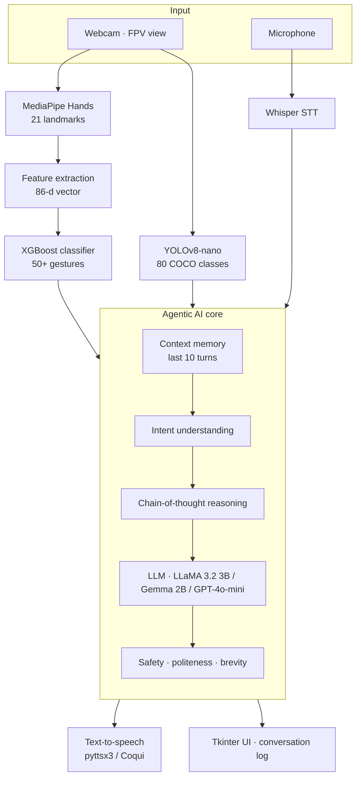

# VoxWear: A Bidirectional Gesture–Speech Communication Assistant Using Agentic AI

**A wearable-perspective assistant that turns hand gestures into natural speech and speech into text. An agentic LLM core adds context: it remembers the conversation and sees the surroundings through YOLOv8. A custom Front-Person-View (FPV) gesture dataset with day and night-vision modalities is included.**

---

## Problem

- **466 million** people worldwide have disabling hearing loss (WHO), and around **70 million** have speech or voice disorders
- Voice communication is impossible on noisy industrial floors (90+ dB)
- Language barriers exist in healthcare and service settings

**Gaps in existing systems:** third-person-view datasets only · poor low-light performance · no context-aware AI · no **bidirectional** communication

## Solution Overview

1. **Gesture → speech:** hand gestures are converted to natural language and spoken aloud
2. **Speech → text:** real-time transcription with Whisper
3. **Agentic AI:** context-aware, multi-turn responses with memory and reasoning
4. **FPV dataset:** a first-person (wearable camera) gesture dataset
5. **Day/night vision:** dual modality (RGB + negative / night-vision images) for round-the-clock use
6. **Environment awareness:** YOLOv8 object detection supplies context

## Architecture



### Multi-threaded runtime

| Thread | Work |
|---|---|
| Main | Video display and coordination |
| 1. Gesture | Capture at 30 FPS, MediaPipe, XGBoost, confidence filter (> 0.7), queue to agent |
| 2. Speech | Continuous audio, 3-second buffers, Whisper, normalise, queue to agent |
| 3. Agent | Read the queues, retrieve memory and context, LLM, queue to output |
| 4. TTS | Synthesise and play the response, update the UI |
| 5. Environment | YOLOv8 every 5 seconds, scene description into the context buffer |

States: `IDLE → LISTENING → PROCESSING → RESPONDING → IDLE`

## VoxWear-FPV Dataset

| Property | Value |
|---|---|
| Perspective | Front Person View (wearable camera at eye level, 1–3 ft from the hands) |
| Classes | 50+ gestures in 6 categories: basic communication, needs and requests, emotions, directions and actions, questions, numbers 0–10 |
| Samples | 200–500 per gesture |
| Modalities | **Normal RGB** and **negative / night vision** (bitwise NOT, green tint, contrast boost) |
| Augmentation | Brightness ±30%, contrast, rotation ±5°, Gaussian blur, noise |
| Metadata | Gesture name, timestamp, lighting condition, handedness |
| Quality control | MediaPipe detection validation, landmark confidence checks, class balancing |

## Gesture Recognition Pipeline

1. **Hand detection (MediaPipe):** 21 landmarks × (x, y, z) = 63 raw features · 20–50 ms
2. **Feature extraction:** wrist-centred, scale-normalised coordinates (63) + inter-landmark distances (15) + finger bend angles (5) + palm orientation (3) = **86 features** · < 5 ms
3. **Classification (XGBoost):** gesture class with a confidence threshold of 0.7 · 10–30 ms
4. **Intent mapping:** for example `hello` → `greeting` · < 1 ms

### Example interaction

> **Input:** gesture `water` + environment *"I see a bottle on the table"*
> **Agent:** intent `drink_request` → bottle visible nearby → offer help with location
> **Response:** *"There's a water bottle on the table to your right. Would you like help reaching it?"*

## Performance

| Component | Metric | Value |
|---|---|---|
| Gesture recognition | Test accuracy | 88–93% |
| | F1 score | 0.87–0.92 |
| | Real-time FPS | 20–30 |
| Speech recognition (Whisper base) | WER, clear speech | < 5% |
| Object detection (YOLOv8n) | mAP@0.5 | 85–90% |
| End-to-end | Gesture → speech | 2–3 s (API backend) |
| | Speech → response | 3–5 s (API backend) |

## Use Cases

- **Healthcare:** speech-impaired patients (for example after a tracheostomy) gesture "pain", "water" or "help" to nurses
- **Industrial:** gesture commands on noisy factory floors
- **Accessibility:** a simple sign vocabulary for non-verbal children
- **Service and retail:** multilingual customer support
- **Smart home:** hands-free control from smart-glasses cameras

## Project Structure

```
VoxWear/
├── voxwear/
│   ├── gesture.py          # MediaPipe landmarks -> 86-d features -> XGBoost
│   ├── speech.py           # Whisper STT + pyttsx3 TTS
│   ├── environment.py      # YOLOv8 scene description
│   └── agent.py            # memory + intent + LLM response generation
├── collect_dataset.py      # FPV dataset recorder (RGB + night-vision + metadata)
├── train_gesture.py        # train the XGBoost gesture classifier
├── main.py                 # multi-threaded real-time assistant
└── requirements.txt
```

## Getting Started

```bash
pip install -r requirements.txt
python collect_dataset.py --gesture hello --samples 200     # repeat per gesture
python train_gesture.py --data dataset
export OPENAI_API_KEY=...        # or run a local model with Ollama: --llm ollama:llama3.2:3b
python main.py
```

## Tech Stack

MediaPipe · XGBoost · OpenCV · OpenAI Whisper · YOLOv8 (Ultralytics) · LLaMA 3.2 / Gemma / GPT-4o-mini · pyttsx3 / Coqui TTS · FastAPI · Tkinter · Python 3.9–3.11

## Team

Amrita Vishwa Vidyapeetham, Coimbatore

- Dodla Nithya Sai
- M. Vishnu Vardhan
- P. Sreekar Reddy
- S. Beena Reddy
